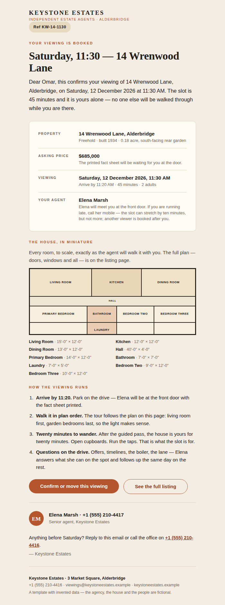
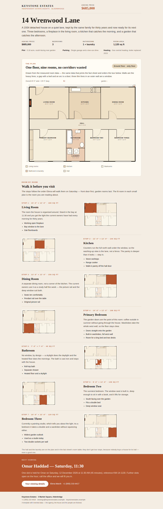
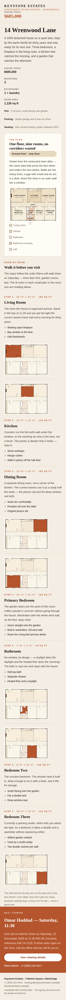
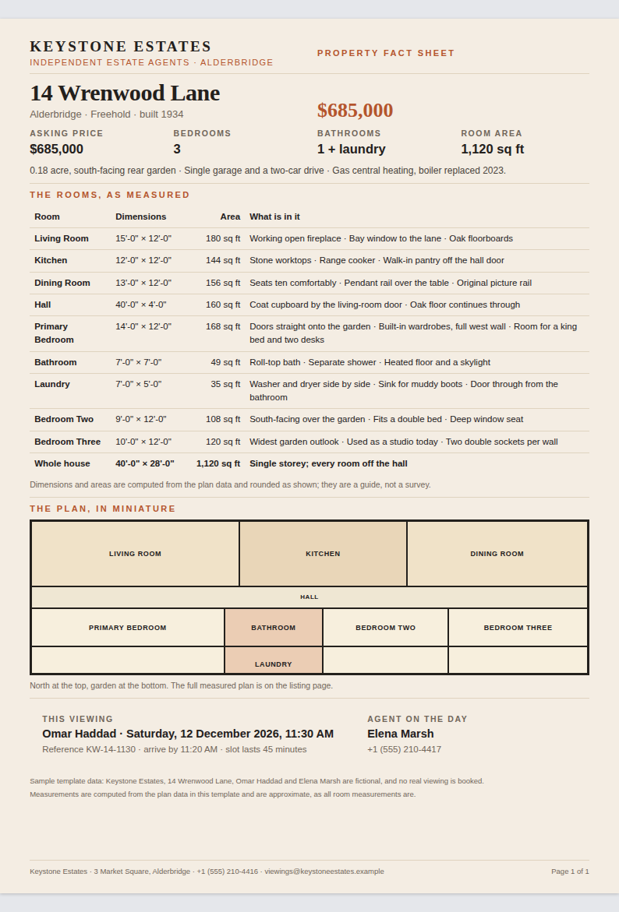
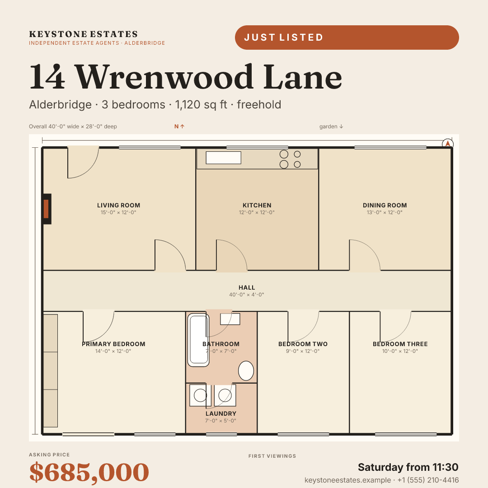

# The Viewing — an open-house kit for a house that is drawn, not photographed

Keystone Estates is selling 14 Wrenwood Lane, and this kit is the paper
trail of one viewing: the email that confirms Omar Haddad's slot on
Saturday at 11:30, the listing page he reads beforehand, the fact sheet
the agent hands him at the door, and the card that announced the house
in the first place.

There are no photographs of this house, because the house does not
exist. What exists is a **room list** — and everything spatial in the
kit is worked out from it.

## The room engine

`src/data.ts` describes the house the way a surveyor would: nine rooms,
each a rectangle inside a 40 ft × 28 ft footprint, with its position,
its doors (which wall, how far along, how wide), its windows, its fixed
fittings, its features and the note the agent will say while standing
in it.

`src/plan.tsx` is the engine that spends that data:

- **The floor plan** (listing page, and again on the social card) is an
  Svg drawing computed rectangle by rectangle: room fills by type,
  walls, door leaves with their swing arcs, window lines in the outer
  walls, the kitchen counter and hob, the bath, the washers, the
  fireplace. Room labels are laid over the drawing in slices cut at
  every room's top and bottom edge, so a label can only ever sit inside
  its own room's rectangle. An Svg cannot hold text, so the labels are a
  layout overlay — but their coordinates come from the same geometry
  functions that draw the walls.
- **The room table** on the fact sheet is the same list, tabulated:
  dimensions and areas are calculated from the rectangles, never typed,
  and the totals row is the sum of the rows above it.
- **The tour** on the listing page is the same list again, in walking
  order, each stop carrying a small copy of the plan with that one room
  lit in terracotta.
- **The mini plan** in the email is the slice geometry rebuilt from
  boxes, because an inbox cannot draw Svg: each horizontal slice of the
  house is a row, each room a labelled cell as wide as its share of the
  footprint.

Move a room in `src/data.ts` — change its `x`/`y`, widen it, swap two
rooms around — and the plan, the table, the tour order's plans and the
email's miniature all change together. Nothing else in the kit mentions
a room's size or position.

## The four outputs

### 1. The confirmation email (600px)



A letter, not a ticket stub: the appointment itself is the headline —
*Saturday, 11:30 — 14 Wrenwood Lane* — followed by a ledger of what was
booked, the house in miniature, the four steps of how the viewing runs,
and the agent's direct number. `render()` also writes its plain-text
twin (`out/email.txt`), and the build writes a preview per email client
(`out/clients/`) showing it as classic Outlook, Gmail and Apple Mail
draw it.

### 2. The listing page (960px)



Printed-particulars manners at the top — address, price, the facts in a
row — then the page gives itself to the plan, and after the plan, the
walk: seven tour stops generated from the room list, each with the plan
re-drawn around the room under discussion. A terracotta band at the
foot holds the viewer's slot. On phones the plan shrinks to a thumbnail
and the tour stacks:



### 3. The fact sheet (A4, one page)



What gets handed over at the front door: headline facts, the measured
room table, the plan in miniature, and the viewing this copy was
printed for — the viewer, the time, the reference, the agent.
`out/fact-sheet.pdf` is exactly one page of A4 (checked with `pdfinfo`
after every build).

### 4. The "Just Listed" card (1080 × 1080)



The announcement card, with the labelled plan doing the talking between
the address and the price. Rendered to PNG and SVG by `renderImage()`.

## How Hyper Elements was used

- **Four roots, chosen per job.** `Email` (600px) for the confirmation,
  `Page` (960px) for the listing, `Document` (A4 portrait) for the fact
  sheet, `Canvas` (1080 × 1080) for the card — each handed the same
  `defineTheme()` brand (`src/theme.ts`): warm sand `#F4EDE3`,
  terracotta `#B4552D`, charcoal `#23201C`, Fraunces for display type
  and Inter for working text. Named styles (`panel`, `kicker`,
  `factLabel`, `chip`) keep the four outputs recognisably one agency's
  paperwork.
- **Svg as the only illustrator.** There is no image file anywhere in
  this project. The plan, its fixtures, its door swings and its north
  arrow are `Rect`, `Line`, `Path`, `Circle`, `Ellipse` and `Polygon`
  elements whose coordinates the engine computes from the room data.
  The email, which cannot draw Svg, gets the box-built miniature
  instead of a picture of one.
- **A `Layer` for the labels.** The plan's room names and dimensions
  sit in a layout overlay on top of the Svg, positioned by the slice
  arithmetic described above — including on the Canvas, where the label
  positions are centred arithmetically because the image engine lays
  text out differently from a browser.
- **Validation as the gate.** `scripts/build.tsx` runs `validate()` on
  all four templates before rendering anything, with the
  `@hyper-elements/email-clients` plugin on the email; the build stops
  on any error. Current state: **0 errors, 0 warnings** on every
  template, render, PDF and image (the plugin's remaining notes are
  info-level: classic Outlook squares the buttons' corners and ignores
  letter-spacing, which degrades gracefully).
- **Local fonts only.** The PDF and the card receive Fraunces and Inter
  as WOFF files from the `@fontsource` packages (`src/fonts.ts`); the
  HTML outputs reference the same families as web fonts. Nothing is
  fetched while building, and no font file is committed.

## Run it

```bash
npm install
npm run build        # validate, then render everything into out/
npm run screenshots  # photograph the outputs into docs/screenshots/
npm run typecheck    # tsc --noEmit
```

Requires Node 20+.

| File | What it is |
| --- | --- |
| `out/email.html`, `out/email.txt` | Confirmation email + plain-text twin |
| `out/page.html` | Listing page with the plan and the tour |
| `out/fact-sheet.html`, `out/fact-sheet.pdf` | Fact sheet, print HTML + PDF (1 page, A4) |
| `out/just-listed.png`, `out/just-listed.svg` | The "Just Listed" card |
| `out/clients/*.html` | The email as Outlook, Gmail and Apple Mail draw it |

## Project structure

```
src/
  data.ts       the house as data: agency, viewer, viewing — and the
                room list every spatial thing is computed from
  plan.tsx      the room engine: FloorPlan (Svg + label overlay),
                PlanThumb (one room lit), MiniPlan (the email's boxes)
  theme.ts      defineTheme(): sand / terracotta / charcoal,
                Fraunces + Inter, named styles
  fonts.ts      local WOFF files for the PDF and image engines
  shared.tsx    the agency nameplate, headline facts, agent block,
                footer line
  email.tsx     the confirmation letter (Email, 600px)
  page.tsx      the listing: particulars, plan, room-by-room tour
  document.tsx  the fact sheet (Document, A4, one page)
  canvas.tsx    the "Just Listed" card (Canvas, 1080 × 1080)
scripts/
  build.tsx       validate gate + all renders + email-client previews
  screenshot.ts   Playwright captures for the visual check
docs/screenshots/ photographs of the four outputs (+ the phone page)
out/              build outputs (gitignored)
```

## A note on the data

All of it is fictional sample data, and the templates say so in their
fine print: Keystone Estates, 14 Wrenwood Lane, Omar Haddad and Elena
Marsh do not exist, no house is for sale, and no viewing is booked. The
`.example` domain is reserved for exactly this. Measurements are
computed from the plan data and are as approximate as the fine print
admits.

## License

MIT — see [LICENSE](LICENSE). Fonts are under the SIL Open Font License.
